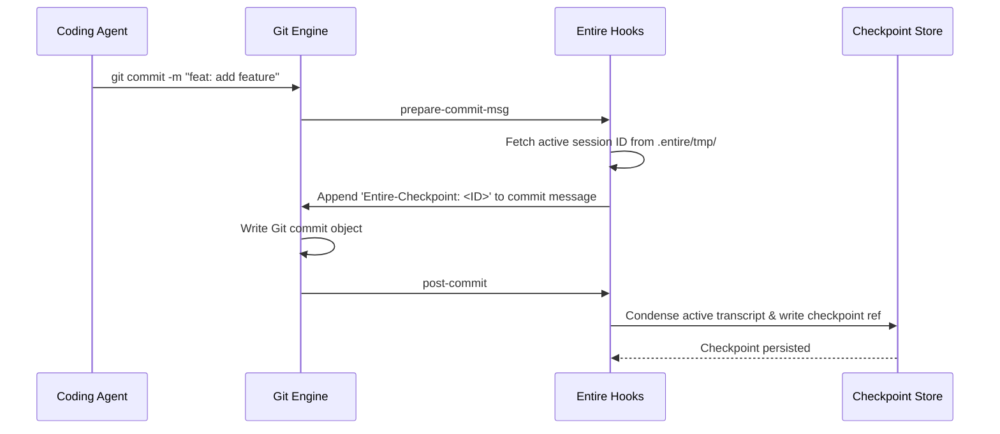

# Checkpoints & Sessions Deep Dive

## How Sessions & Checkpoints Work

Entire separates developer activity into two layers:
1. **Dynamic Layer (Sessions):** Tracks the real-time stream of prompts, thoughts, tool inputs, and tool outputs as an agent works.
2. **Persistent Layer (Checkpoints):** When a Git commit is created, Entire condenses the active session up to that point into an immutable **Checkpoint**, attaching it to the commit.

---

## 1. The Git Hook Mechanics

When `entire enable` runs, it installs three critical Git hooks in `.git/hooks/`:



### The Commit Trailer
Every commit tracked by Entire contains a trailer formatted as:
```text
Entire-Checkpoint: 01M69CNHH9D2092QYTZJ9FMEQ0
```
This ID is a ULID (Universally Unique Lexicographically Sortable Identifier) ensuring chronological order and global uniqueness.

---

## 2. Storage Architecture: Git Refs

By default (`"type": "git-refs"` in `.entire/settings.json`), Entire does **not** clutter your working tree or standard commit graph with metadata branches. Instead, it writes checkpoints to specialized Git references:

- Checkpoints: `refs/entire/checkpoints/<ULID>`
- Session manifests: `refs/entire/sessions/<SESSION_ID>`

When you run `git push`, Entire's `pre-push` hook pushes both your normal branch heads and these checkpoint refs to your Entire forge cluster (or configured checkpoint remote).

---

## 3. Privacy & Secret Redaction

Before writing transcripts to checkpoints, Entire runs a local redactor engine:
- High-entropy tokens (API keys, private tokens, passwords) are automatically detected and replaced with placeholders like `[REDACTED_ENTROPY_TOKEN]`.
- Custom redaction patterns can be configured in `.entire/settings.json`.
- The commit log only publishes redacted session data.

---

## 4. `entire why` Resolution Pipeline

When you run `entire why <file>:<line>`:
1. Entire executes a localized `git blame` on the specified line to locate the Git commit SHA.
2. It parses the commit message to extract the `Entire-Checkpoint: <ID>` trailer.
3. It resolves the Checkpoint from local refs (or queries the cluster if missing).
4. It parses the session transcript to extract the **exact user prompt** that preceded the file change.
5. It prints the prompt, author, agent name, and timestamp.
